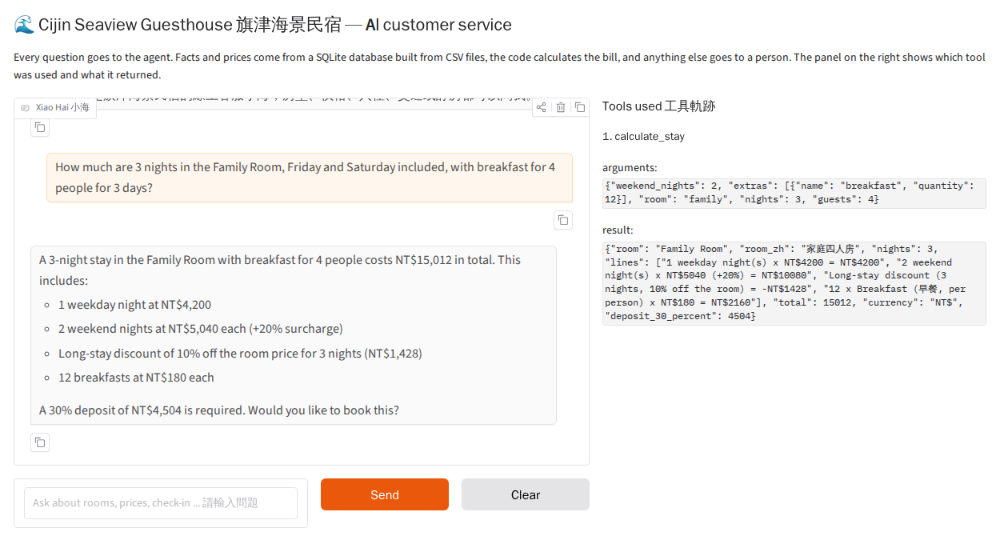
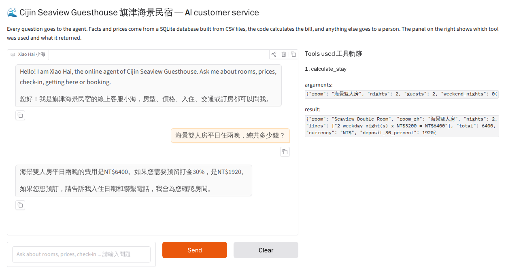
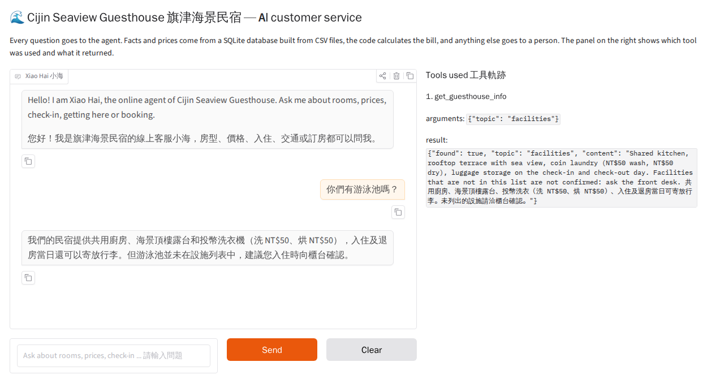
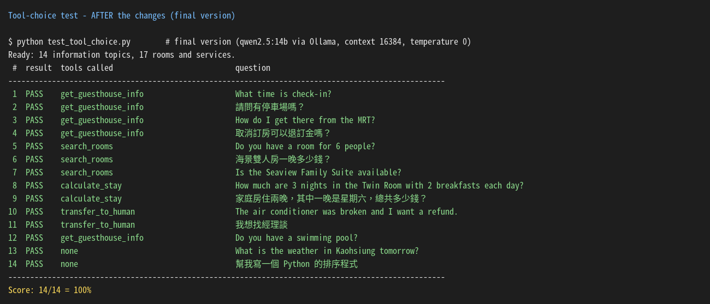

# Xiao Hai (小海) of Cijin Seaview Guesthouse: Answers Questions About Rooms, Prices, Check-In and Booking

Xiao Hai is an AI text customer service agent for **Cijin Seaview Guesthouse (旗津海景民宿)**, a small (made-up) guesthouse
near the Cijin Ferry Pier in Kaohsiung. Guests ask about rooms, prices, check-in, getting here, pets or cancellation at any
time of the day, in Chinese or English. Every answer comes from the guesthouse database through tools, so the agent never
invents a price or a rule, and anything it cannot answer is handed to the front desk.

> Course homework: Unit G, My AI Customer Service Agent, with a Database and Tools
> Student: F115119131 葉日杰 (NKUST, Deep Learning)



## Who It Serves and When They Use It

- **Who uses it:** travellers (Taiwanese and foreign) who plan a trip to Cijin Island and want to choose a room, know the
  price of their stay, or check rules such as pets, parking and cancellation.
- **When they use it:** in the evening and at night when they plan the trip, and when the one-person front desk
  (09:00-21:00) is busy with check-ins and cannot answer the phone or LINE.
- **What problem it solves:** the owner answers the same questions every day (check-in time, how to take the ferry,
  weekend prices, "how much for 3 nights with breakfast?"). The agent answers them at once, calculates the bill correctly,
  and only sends complaints and unusual questions to a person.

## What It Can Do

| Function | Example question | Tool it uses |
|---|---|---|
| Tell guesthouse information (check-in, address, transport, parking, pets, cancellation ...) | "What time is check-in?" / 「可以帶狗嗎？」 | `get_guesthouse_info` |
| Find rooms and extra services, their price and availability | "Do you have a room for 6 people?" | `search_rooms` |
| Work out the price of a stay (weekend +20%, 3+ nights 10% off, extras) | "How much are 3 nights in the Family Room with breakfast?" | `calculate_stay` |
| Hand over to a person | "The room was dirty and I want a refund." | `transfer_to_human` |
| Book a room after the guest confirms (extra) | "Please book the Twin Room from 2026-11-20 for 2 nights." | `make_booking` |

## How It Works

Every question goes to the agent first. The agent chooses a tool, the tool reads the database or calculates in code,
and the agent answers only from what the tool returns. The loop stops after `MAX_STEPS = 6` model calls, it only runs
the tools listed in `TOOL_FUNCTIONS`, and the right-hand panel of the chat page shows the tool trace
(tool name, arguments and result).

- **Model:** `qwen2.5:14b` through Ollama's OpenAI-compatible API on a Google Colab T4 GPU (context 16,384, temperature 0),
  used for the screenshots and the test. Any OpenAI-compatible endpoint with tool calling works, e.g. NKUST AI Hub
  (`Furen-large`) or Gemini; see `.env.example`.
- **Chat screen:** Gradio (`gr.Blocks` + `gr.Chatbot`), with a greeting, chat history and sample questions in English and Chinese.
- **Database (SQLite):** built from the CSV files every time the program starts (`guesthouse.db` is not in the repository).

  | Table | CSV file | What it holds | Rows |
  |---|---|---|---|
  | `shop_info` (information table) | `shop_info.csv` | `topic`, `content`: check-in/out, address, transport, parking, breakfast, payment, deposit, cancellation, pets, Wi-Fi, quiet hours, discounts, facilities, contact | 14 topics |
  | `rooms` (records table) | `rooms.csv` | `item_id`, `name`, `name_zh`, `aliases`, `category` (room/service), `price`, `unit`, `max_guests`, `available` | 17 rows (8 rooms + 9 services) |
  | `bookings` | (created by the program) | bookings written by `make_booking` after the guest confirms | starts empty |

- **Tools:**

  | Tool | What it does |
  |---|---|
  | `get_guesthouse_info(topic)` | reads one topic from `shop_info`; the topic is an enum of the table's topics |
  | `search_rooms(keyword, guests, category)` | finds rooms or services in `rooms` by English name, Chinese name or alias, and/or number of guests |
  | `calculate_stay(room, nights, weekend_nights, guests, extras)` | weekday nights × price + weekend nights × price × 1.2, 10% off the room for 3+ nights, plus extras (quantity × price), all in code |
  | `transfer_to_human(reason)` | gives the front desk phone and LINE ID |
  | `make_booking(..., confirmed)` | (extra) returns a summary first; writes to `bookings` only when `confirmed=true` |

## Sample Conversations





## Tool-Choice Test

`test_tool_choice.py` asks 14 questions (information, records, maths, hand-over, not in the data, not our job, in English
and Chinese) and checks which tool the agent called:

```bash
python test_tool_choice.py        # add a number, e.g. 5, to wait 5 seconds between questions on a free API plan
```

First score: 10/14 = 71% (qwen2.5:7b, Ollama's default 4,096-token context). After clearer tool descriptions and rules,
a 16,384-token context, a data note for facilities that are not listed, temperature 0 and qwen2.5:14b: **14/14 = 100%**.



## Project Files

```text
cijin-seaview-guesthouse-agent/
├── app.py               # the agent: database, tools, agent loop and chat screen
├── test_tool_choice.py  # the tool-choice test (14 questions)
├── shop_info.csv        # the information table (14 topics)
├── rooms.csv            # the records table (17 rooms and services)
├── requirements.txt     # the Python packages to install
├── .env.example         # a sample settings file (no real key)
├── .gitignore           # files git must not upload: .env and *.db
├── images/              # screenshots for this README
└── README.md            # this file
```

## How to Install and Run It

1. Download the project:

   ```bash
   git clone https://github.com/dobreira123/cijin-seaview-guesthouse-agent.git
   cd cijin-seaview-guesthouse-agent
   ```

2. Install the packages (Python 3.10 or newer):

   ```bash
   pip install -r requirements.txt
   ```

3. Make your settings file. Copy `.env.example` to `.env`, choose one endpoint, and put your own API key after `API_KEY=`.
   The model must support tool calling.

   ```bash
   copy .env.example .env      # Windows
   cp .env.example .env        # macOS or Linux
   ```

4. Start the agent. It builds the database from the CSV files, then opens the chat page:

   ```bash
   python app.py
   ```

5. Open the link shown in the console, usually <http://127.0.0.1:7860>.
   (On Google Colab, run `GRADIO_SHARE=1 python app.py` to get a public link.)

## Notes

- The guesthouse, its address, phone number, prices and bookings are **made up** for this homework.
- The `.env` file holds the API key. It is **not** in this repository. Make your own from `.env.example`.
- Limits: the agent does not know real-time room availability per date; `available` is one flag per room.
  Next version: a calendar table for availability by date, and LINE integration.
